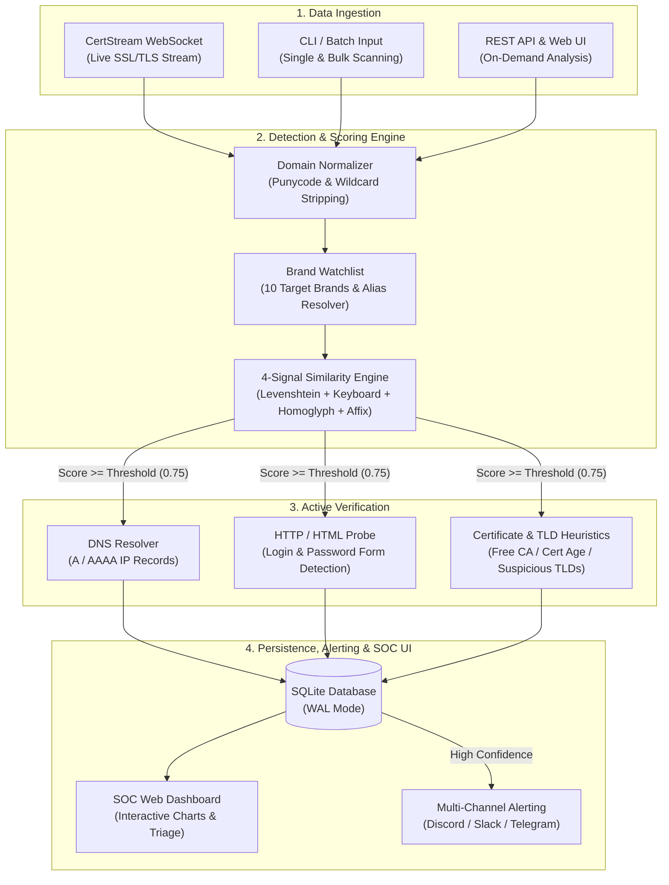
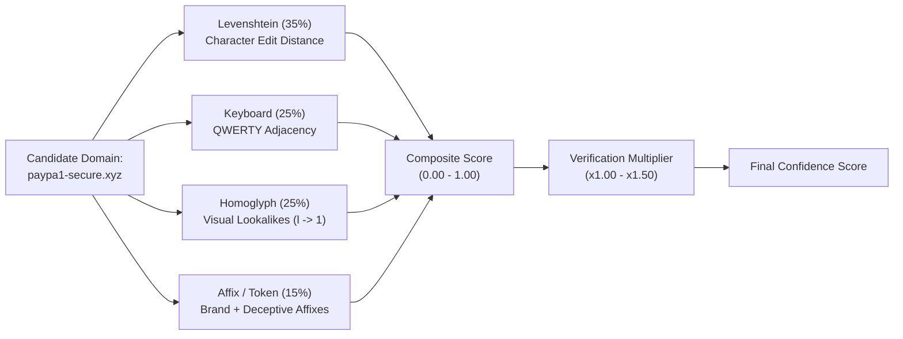
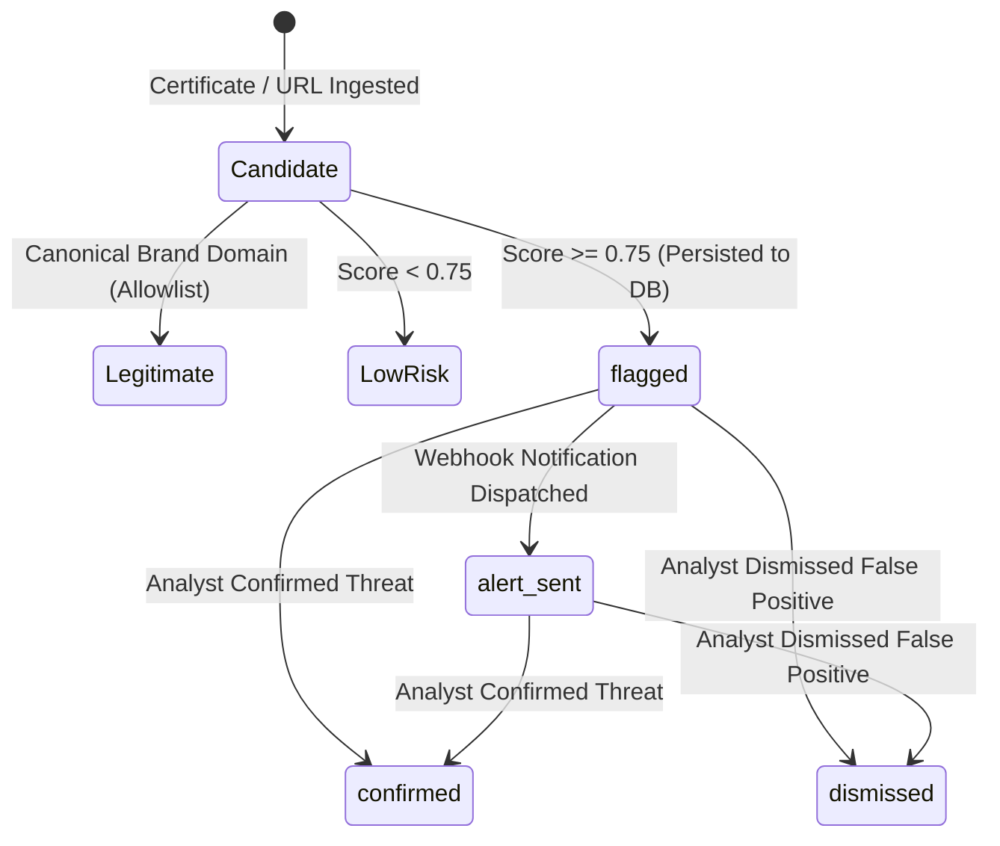
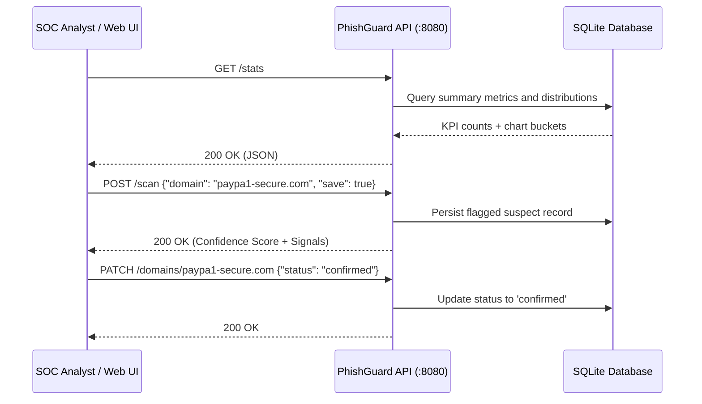

<div align="center">

# PhishGuard-CT

**Real-Time Certificate Transparency Phishing Detection and SOC Triage Platform**

[](https://github.com/Bor-Code/Phishguard-Ct/actions/workflows/ci.yml)
[](https://www.python.org/downloads/)
[](LICENSE)
[](CHANGELOG.md)
[](reports/evaluation_report.json)

</div>

---

## 1. System Architecture



---

## 2. Multi-Signal Scoring Pipeline



| Signal | Weight | Target Attack Vector | Example |
| :--- | :---: | :--- | :--- |
| **Levenshtein** | `35%` | Character insertions, deletions, substitutions | `paypaI.com`, `gooogle.com` |
| **Keyboard** | `25%` | Adjacent QWERTY key typosquatting | `payoal.com`, `gppgle.com` |
| **Homoglyph** | `25%` | Visual lookalikes (`0`/`o`, `1`/`l`, IDN Cyrillic) | `paypa1.com`, `faceb00k.com` |
| **Affix / Subdomain** | `15%` | Brand combo-squatting and deceptive tokens | `paypal-login-verify.xyz` |

---

## 3. Threat Triage Lifecycle



---

## 4. SOC Web Console Layout

```text
+-----------------------------------------------------------------------------------+
| PhishGuard-CT SOC Console v1.0.0             [Export JSON] [Export CSV] [Refresh] |
+--------------------+--------------------------------------------------------------+
| > Overview & Charts|  [ Flagged: 24 ]  [ Live Threats: 18 ]  [ Brands: 10 ]       |
| > Threat Explorer  |                                                              |
| > Batch Scanner    |  +----------------------+  +------------------------------+  |
| > Brand Watchlist  |  |  (O) Status Donut    |  |  Critical >=0.90 [########]  |  |
|                    |  |      flagged / sent  |  |  High 0.75-0.89  [#####   ]  |  |
|                    |  +----------------------+  +------------------------------+  |
|                    |                                                              |
|                    |  Domain                        Brand    Score    Actions     |
|                    |  ----------------------------------------------------------  |
|                    |  paypa1-secure-verify.com      paypal   0.9850   [Inspect]   |
|                    |  g00gle-workspace-sso.xyz      google   0.9240   [Confirm]   |
+--------------------+--------------------------------------------------------------+
```

---

## 5. Quick Start

### Installation

```bash
git clone https://github.com/Bor-Code/Phishguard-Ct.git
cd Phishguard-Ct
python -m venv .venv
.\.venv\Scripts\activate   # Linux/macOS: source .venv/bin/activate
pip install -e ".[dev]"
```

### CLI Commands

| Operation | Command |
| :--- | :--- |
| **Start SOC Web Dashboard & API** | `phishguard serve --host 127.0.0.1 --port 8080` |
| **Stream Live CT Logs** | `phishguard monitor --min-score 0.75` |
| **Inspect Single Domain / URL** | `phishguard scan paypa1-login.xyz --json` |
| **Run Bulk File Scan** | `phishguard batch domains.txt --output results.json` |
| **Export Flagged Database** | `phishguard export threats.csv --format csv` |
| **Run Benchmark Evaluation** | `phishguard evaluate --output-dir reports` |

---

## 6. REST API Sequence & Reference



| Method | Endpoint | Description |
| :---: | :--- | :--- |
| `GET` | `/` or `/dashboard` | Interactive SOC Web Dashboard |
| `GET` | `/health` | Service health status and version |
| `GET` | `/stats` | Summary metrics, severity buckets, and signal averages |
| `GET` | `/domains` | Filtered list of flagged domains (`?brand=`, `?status=`, `?min_score=`) |
| `GET` | `/domains/{domain}` | Full domain record, signals, and certificate telemetry |
| `PATCH` | `/domains/{domain}` | Update domain triage status (`confirmed` / `dismissed`) |
| `POST` | `/scan` | On-demand single domain/URL inspection |
| `POST` | `/batch-scan` | Concurrent bulk domain inspection |
| `GET` | `/watchlist` | Protected target brands, keywords, and canonical domains |
| `GET` | `/export` | Download detections as `JSON` or `CSV` (`?format=csv`) |

---

## 7. Benchmark Performance

| Metric | Result |
| :--- | :---: |
| **Total Samples** | `44` (`24` Phishing / `20` Benign) |
| **True Positives (TP) / False Positives (FP)** | `24` / `0` |
| **Precision** | **`100%` (`1.0000`)** |
| **Recall** | **`100%` (`1.0000`)** |
| **F1-Score** | **`100%` (`1.0000`)** |

---

## 8. Docker & Testing

```bash
# Run with Docker Compose
docker compose up -d --build

# Execute unit and integration test suite
pytest
```

---

## License

Released under the [MIT License](LICENSE).
