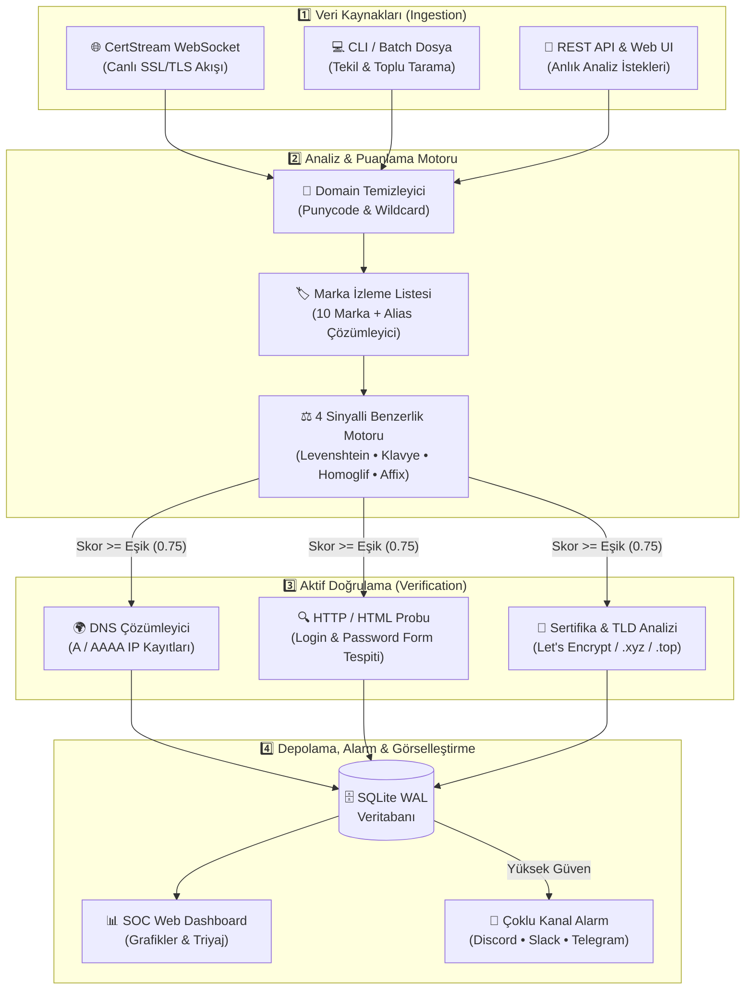
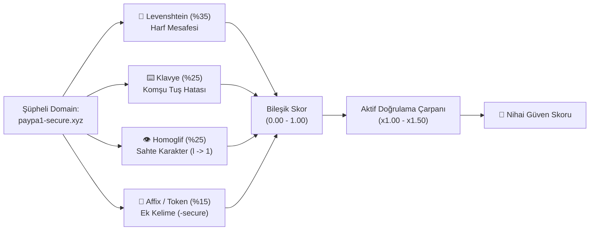
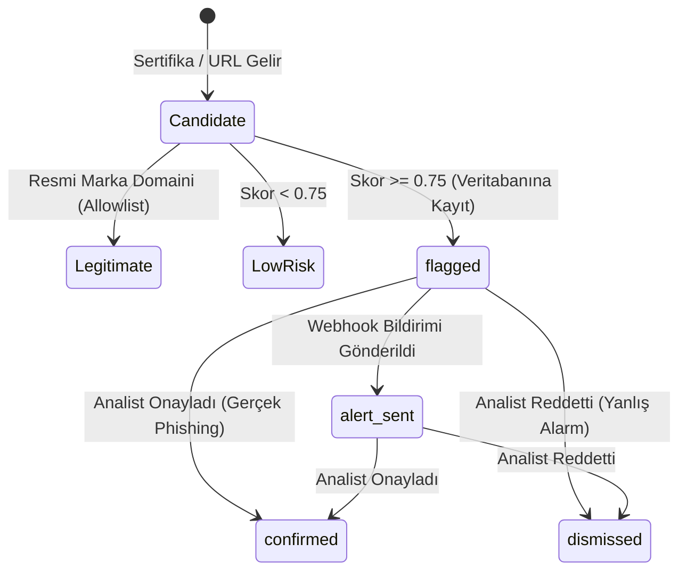
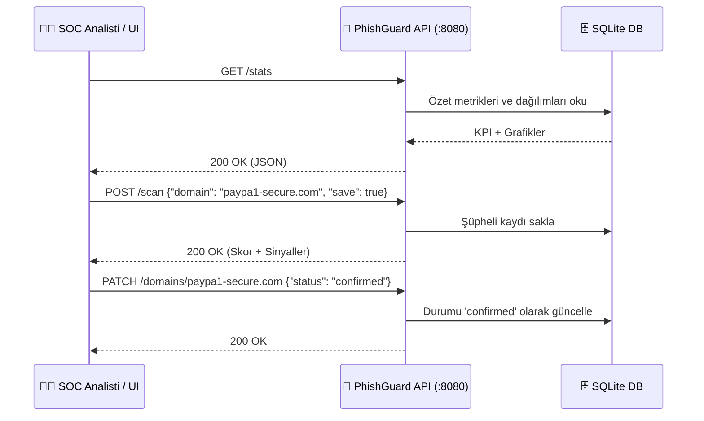

<div align="center">

# 🛡️ PhishGuard-CT

**Real-Time Certificate Transparency Phishing Detection & SOC Triage Platform**

[](https://github.com/Bor-Code/Phishguard-Ct/actions/workflows/ci.yml)
[](https://www.python.org/downloads/)
[](LICENSE)
[](CHANGELOG.md)
[](reports/evaluation_report.json)

</div>

---

## 🗺️ 1. Sistem Mimarisi (System Overview)



---

## 🧠 2. 4 Sinyalli Puanlama Motoru Nasıl Çalışır?



| Sinyal | Ağırlık | Yakaladığı Saldırı Tipi | Örnek |
| :--- | :---: | :--- | :--- |
| **Levenshtein** | `%35` | Harf ekleme / silme / değiştirme | `paypaI.com`, `gooogle.com` |
| **Keyboard** | `%25` | QWERTY klavyede komşu tuşa basma | `payoal.com`, `gppgle.com` |
| **Homoglyph** | `%25` | Görsel ikiz harfler (`0`/`o`, `1`/`l`, Kiril) | `paypa1.com`, `faceb00k.com` |
| **Affix / Subdomain** | `%15` | Marka + yanıltıcı ek kelimeler | `paypal-login-verify.xyz` |

---

## 🔄 3. Tehdit Yaşam Döngüsü (SOC Triage State Flow)



---

## 🖥️ 4. SOC Web Dashboard Görünümü

```text
+-----------------------------------------------------------------------------------+
| 🛡️ PhishGuard-CT SOC Console v1.0.0          [Export JSON] [Export CSV] [Refresh] |
+--------------------+--------------------------------------------------------------+
| ▸ Overview & Charts|  [ Flagged: 24 ]  [ Live Threats: 18 ]  [ Brands: 10 ]       |
| ▸ Threat Explorer  |                                                              |
| ▸ Batch Scanner    |  +----------------------+  +------------------------------+  |
| ▸ Brand Watchlist  |  |  (O) Status Donut    |  |  Critical >=0.90 [████████]  |  |
|                    |  |      flagged / sent  |  |  High 0.75-0.89  [█████   ]  |  |
|                    |  +----------------------+  +------------------------------+  |
|                    |                                                              |
|                    |  Domain                        Brand    Score    Actions     |
|                    |  ----------------------------------------------------------  |
|                    |  paypa1-secure-verify.com      paypal   0.9850   [Inspect]   |
|                    |  g00gle-workspace-sso.xyz      google   0.9240   [Confirm]   |
+--------------------+--------------------------------------------------------------+
```

---

## ⚡ 5. Hızlı Başlangıç (Quick Start)

### Kurulum

```bash
git clone https://github.com/Bor-Code/Phishguard-Ct.git
cd Phishguard-Ct
python -m venv .venv
.\.venv\Scripts\activate   # Linux/macOS: source .venv/bin/activate
pip install -e ".[dev]"
```

### Temel Komutlar

| Amaç | Komut |
| :--- | :--- |
| **🌐 Web Dashboard & API Başlat** | `phishguard serve --host 127.0.0.1 --port 8080` |
| **📡 Canlı CT Akışını İzle** | `phishguard monitor --min-score 0.75` |
| **🔍 Tekil Domain / URL Tara** | `phishguard scan paypa1-login.xyz --json` |
| **📂 Toplu Dosya Tara** | `phishguard batch domains.txt --output results.json` |
| **📤 Veritabanını Dışa Aktar** | `phishguard export threats.csv --format csv` |
| **🧪 Benchmark Testini Çalıştır** | `phishguard evaluate --output-dir reports` |

---

## 🔌 6. REST API Uç Noktaları



| Metot | Uç Nokta | Açıklama |
| :---: | :--- | :--- |
| `GET` | `/` veya `/dashboard` | İnteraktif SOC Web Arayüzü |
| `GET` | `/health` | Servis sağlık ve versiyon kontrolü |
| `GET` | `/stats` | Grafik ve KPI istatistikleri |
| `GET` | `/domains` | Yakalanan domain listesi (`?brand=`, `?status=`, `?min_score=`) |
| `GET` | `/domains/{domain}` | Tekil domain tam analiz ve sertifika detayı |
| `PATCH` | `/domains/{domain}` | Analist durum güncellemesi (`confirmed` / `dismissed`) |
| `POST` | `/scan` | Tekil domain/URL anlık analizi |
| `POST` | `/batch-scan` | Çoklu domain toplu analizi |
| `GET` | `/watchlist` | Korunan markalar ve anahtar kelimeler |
| `GET` | `/export` | `JSON` veya `CSV` rapor indirme (`?format=csv`) |

---

## 📊 7. Benchmark Sonuçları

| Metrik | Sonuç |
| :--- | :---: |
| **Toplam Örneklem** | `44` (`24` Oltalama / `20` Güvenli) |
| **Doğru Pozitif (TP) / Yanlış Pozitif (FP)** | `24` / `0` |
| **Kesinlik (Precision)** | **`100%` (`1.0000`)** |
| **Duyarlılık (Recall)** | **`100%` (`1.0000`)** |
| **F1-Skoru** | **`100%` (`1.0000`)** |

---

## 🐳 8. Docker & Testler

```bash
# Docker ile çalıştırma
docker compose up -d --build

# Birim testlerini çalıştırma
pytest
```

---

## 📄 Lisans

Bu proje [MIT Lisansı](LICENSE) altında lisanslanmıştır.
