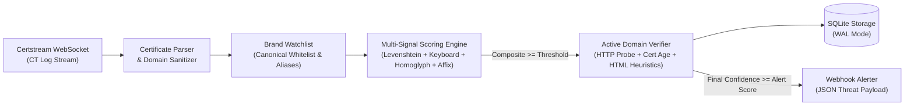

# PhishGuard-CT

Real-time phishing domain detection and monitoring system powered by **Certificate Transparency (CT)** logs, multi-signal linguistic/visual similarity scoring, active HTTP/TLS verification heuristics, SQLite persistence, and webhook alerting.

---

## Architecture



---

## Key Features

- **Real-Time CT Log Ingestion (`phishguard.ingestion`)**: Streams newly issued TLS certificates over WebSocket (`wss://api.certstream.dev/domains-only`) with automatic exponential backoff reconnection, wildcard stripping, and Punycode normalization.
- **Brand Watchlist & Alias Resolution (`phishguard.watchlist`)**: Manages protected brands, canonical domains (for zero-false-positive whitelisting), and brand keywords/aliases (e.g., `facebook`/`instagram` -> `meta`, `outlook`/`office365` -> `microsoft`, `icloud` -> `apple`).
- **Multi-Signal Scoring Engine (`phishguard.scoring`)**:
  - **Levenshtein Similarity (`35%`)**: Edit distance for single/multi-character insertions, deletions, and substitutions.
  - **QWERTY Keyboard Adjacency (`25%`)**: Penalizes adjacent-key typos (`payoal` vs `paypal`) less than distant-key edits to accurately surface typosquatting.
  - **Homoglyph & IDN Normalization (`25%`)**: Detects Cyrillic, Greek, and digit lookalikes (`gооgle`, `pαypal`, `paypa1`, `faceb00k`).
  - **Subdomain & Affix Matching (`15%`)**: Identifies brand combo-squatting (`paypal-security-update.com`, `login.micros0ft-online-verify.net`).
- **Active Verification Layer (`phishguard.verification`)**: Performs asynchronous HTTP/HTTPS reachability probes, evaluates certificate issuance age and free automated CA usage (e.g., Let's Encrypt, ZeroSSL), and inspects HTML for `<input type="password">`, login forms, and suspicious phishing keywords.
- **SQLite Storage & Migrations (`phishguard.storage`)**: Persists flagged domain records with WAL concurrency, schema versioning, status tracking (`flagged`, `alert_sent`), and filtered query support.
- **Webhook Alerting (`phishguard.alerting`)**: Dispatches structured JSON threat intelligence payloads to external SIEM/SOAR or messaging webhooks.
- **Benchmark Evaluation Pipeline (`phishguard.evaluation`)**: Evaluates precision, recall, F1-score, and false positive rate against PhishTank, OpenPhish, and benign domain datasets, exporting JSON and CSV artifacts.

---

## Installation

### Local Setup (Python 3.11+)

```bash
python -m venv .venv
# Windows
.\.venv\Scripts\activate
# Linux / macOS
source .venv/bin/activate

pip install -e ".[dev]"
```

### Configuration

Copy `.env.example` to `.env` and adjust as needed:

```ini
CERTSTREAM_URL=wss://api.certstream.dev/domains-only
ALERT_WEBHOOK_URL=
DATABASE_PATH=phishguard.db
LOG_LEVEL=INFO
MIN_ALERT_SCORE=0.75
WATCHLIST_PATH=config/brands.json
HTTP_TIMEOUT_SECONDS=5.0
```

---

## Usage (CLI)

PhishGuard provides a unified CLI via `phishguard` (or `python -m phishguard`):

### 1. Real-Time Monitoring

```bash
phishguard monitor --watchlist config/brands.json --min-score 0.75
```

Process a bounded number of certificate events:

```bash
phishguard monitor --max-events 100
```

### 2. Run Benchmark Evaluation

```bash
phishguard evaluate \
  --phishtank data/benchmarks/phishtank_sample.json \
  --openphish data/benchmarks/openphish_sample.txt \
  --benign data/benchmarks/benign_sample.txt \
  --output-dir reports \
  --threshold 0.75
```

### 3. List Flagged Domains

```bash
phishguard list --db phishguard.db --min-score 0.80 --brand paypal --limit 25
```

### 4. Scan a Single Domain or URL

```bash
phishguard scan https://paypa1-security-verification.com/login --json
```

Skip active HTTP probing (offline scoring only):

```bash
phishguard scan faceb00k-security-notice.info --no-verify
```

### 5. Start REST API & Healthcheck Server

```bash
phishguard serve --host 0.0.0.0 --port 8080 --with-monitor
```

Available HTTP Endpoints:
- `GET /` or `GET /dashboard` — Interactive dark-mode SOC Web Dashboard & Live Domain Analyzer
- `GET /health` — Service health status and version
- `GET /stats` — Summary counts (`total_flagged`, `live_domains`, `alerts_sent`, `by_brand`)
- `GET /domains?brand=paypal&min_score=0.80&limit=50` — Filtered list of flagged domains
- `GET /domains/{domain}` — Detailed record for a specific domain
- `POST /scan` — On-demand domain analysis (`{"domain": "...", "verify": false, "save": true}`)
```bash
# Example health check
curl http://localhost:8080/health
```
```

---

## Docker Deployment

Build and run with Docker Compose:

```bash
docker compose up -d --build
```

Run benchmark evaluation inside the container:

```bash
docker compose run --rm phishguard evaluate
```

---

## Benchmark Results

Evaluated against the bundled PhishTank, OpenPhish, and Benign sample datasets (`reports/evaluation_report.json`):

| Metric | Value |
| :--- | :--- |
| **Total Samples** | `44` (`24` Phishing / `20` Benign) |
| **True Positives (TP)** | `24` |
| **False Positives (FP)** | `0` |
| **True Negatives (TN)** | `20` |
| **False Negatives (FN)** | `0` |
| **Precision** | `1.0000` (`100%`) |
| **Recall** | `1.0000` (`100%`) |
| **F1-Score** | `1.0000` (`100%`) |
| **False Positive Rate (FPR)** | `0.0000` (`0%`) |

---

## Running Tests

```bash
pytest
```
